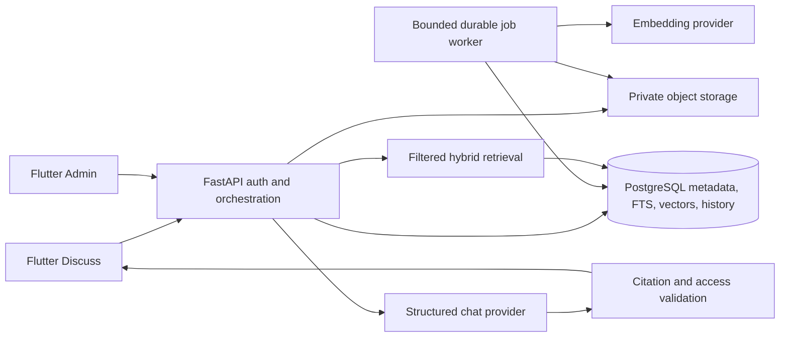

# Phase 2 implementation report

21 October 2026. Phase 2 is implemented for local development; production acceptance remains pending provider and deployment configuration. The user explicitly deferred OpenAI setup. No live OpenAI answer, production storage upload, native pgvector query or Vercel deployment is claimed.

## Repository audit and preserved foundation

Phase 1 already provided separate Flutter User and Admin applications, a shared design system/API client, FastAPI authentication, roles, sessions, company ownership, content modules, Alembic and PostgreSQL. Discuss and Admin AI were presentation placeholders. Those two workspaces now call the backend. Existing authentication, route guards, navigation, Lato/Libre Baskerville typography, lavender/violet/peach branding and green status text and unrelated modules remain in use. Reference images remain under the supplied targetUI directory.

## Implemented modules

- Server provider interfaces and an official OpenAI Responses/embeddings adapter; model IDs are configurable and no API key is shipped to Flutter.
- Private local development and private S3 storage adapters, immutable versions, extraction, page previews, structural chunks and persisted resumable jobs.
- PostgreSQL full-text plus vector retrieval, access and applicability filters, rank fusion and surrounding context.
- Structured answers, server-validated passage identifiers and quotations, saved evidence/configuration snapshots, owner-only history, cancellation, feedback and usage limits.
- User Discuss history, validated answer streaming, responsive source cards, authenticated page images, exact-page original links and Markdown tables.
- Admin AI Knowledge Base with upload, metadata, lifecycle/approval, version history, preview, jobs, settings and aggregate analytics.
- Three clearly marked two-page fictional demonstration PDFs, development seed tooling, tests and release web builds.

## Changed files and routes

New backend modules are in `backend/app/ai/`: models, schemas, providers, storage, access, configuration, ingestion, retrieval, chat, api, worker, retention, demo_pdfs, dev and dev_seed. Integration changes register models/routes in existing backend modules, extend core configuration, update dependencies and add migration `0003_ai_research.py` and AI tests. Flutter changes are `apps/dsbca_user/lib/research.dart`, `apps/dsbca_admin/lib/knowledge.dart`, their existing app integration, shared API client and associated pubspec/lock/test files. `/discuss` and Admin `ai` retain their routes. Phase 1 modules are not rebuilt.

## Local activation and remaining work

The supplied Neon database supports the vector extension and was inspected read-only. Its Phase 1 schema was preserved: migration 0003 was applied only to isolated local databases. Local development uses PostgreSQL 17, TLS and explicit exact-vector mode because the installed local server lacks native pgvector. This mode retains genuine vector similarity plus PostgreSQL FTS; its 1,000-candidate cap is unsuitable for a large production library.

Live activation requires a separate Neon development branch, approved chat/embedding model IDs and OpenAI key, private S3 settings, a scheduled authenticated worker runner, and Vercel project access. Re-run the real administrator-upload to generated-answer to exact-page workflow there before accepting Phase 2. Optional OCR, reranking and official-web verification are intentionally unavailable and clearly reported.

Phase 3 should wait for that acceptance run. No additional calculators, compliance automation or learning feature expansion was implemented.

See [test results](PHASE2_TEST_RESULTS.md), [deployment](PHASE2_DEPLOYMENT.md) and the component guides.
