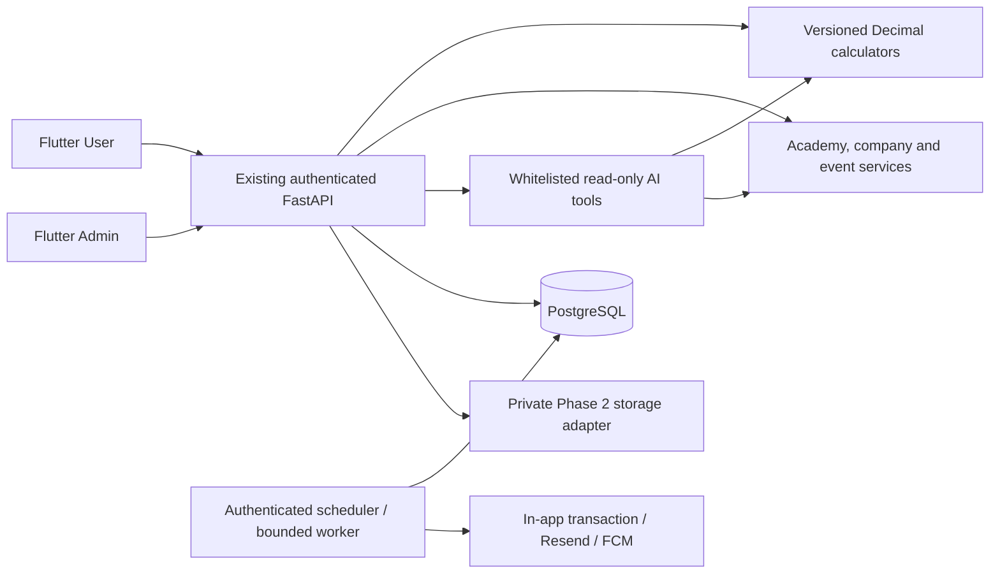

# Phase 3 architecture and implementation report

21 October 2026. Phase 3 extends the existing Flutter/FastAPI platform. All services use existing authentication, roles, shared design system and SQLAlchemy sessions. No shared Neon schema was modified. OpenAI remains deferred; email, push, hosted storage, a Neon development branch and Vercel projects are not configured.

## Audit

Phase 1 supplied content/company CRUD, simple reminders, articles/bookmarks, notifications and a limited gratuity screen. It did not supply a full academy, durable delivery, registration/capacity, legal rule publication or a professional toolkit. Phase 2 supplied real private PDF processing, hybrid retrieval, citations and Discuss history, but live OpenAI and production acceptance remained pending. Those boundaries remain explicit.

## Modules

- `backend/app/calculators`: 14 pure Decimal engines/form contracts, official reference templates and explicit numerical/coverage limits.
- `backend/app/professional`: additive models, typed requests, authenticated REST APIs, company-field encryption, durable scheduling/delivery, whitelisted application tools and isolated development seed/worker.
- `apps/dsbca_user/lib/professional.dart`: catalogue, calculator editors/results/schedules/history, learning library, notification preferences/subscriptions/delivery state.
- `academy.dart`: actual video_player playback, persisted progress/resume, speed/fullscreen, bookmarks, chapters, authorized resources and webinar registration/calendar/joining flows.
- `compliance.dart` and `media.dart`: company profiles/people/documents, private attachments, renewal/status history, obligations and reminder schedules.
- `apps/dsbca_admin/lib/professional.dart`: source-backed rule drafts/validation/review, learning metadata, regulatory workflow, webinar management, delivery controls and aggregate metrics.

Existing `/learn`, `/toolkit`, `/reminders`, `/updates`, content and Discuss routes are retained. New detail/library/settings routes extend the same five-tab User navigation. Admin adds a Professional platform workspace and connects existing content/update/delivery/compliance navigation to its relevant tabs. Legacy public gratuity services remain available for existing clients; the new toolkit uses the backend engines.

## Persistence and migration

Migration 0004 adds 18 focused tables and extends existing content/company/document/preference records. Inputs/results/rule snapshots share calculator_runs rather than redundant input/result tables. Existing AppSetting records store notification template definitions. Existing publications/chapters, companies/people/documents, webinar records and in-app notification/recipient tables are reused.

All account-owned saved records persist through the configured PostgreSQL connection. Anonymous unsaved arithmetic is rate-limited and does not create account history; saving requires sign-in. Private company JSON facts and renewal history are encrypted with a separate AES-256-GCM key. New legacy TRN writes move into the encrypted profile while preserving the response contract. Existing legacy plaintext TRNs are not silently rewritten by migration.

## Activation status

Local development runs against `dsbca_phase3_dev`, with explicit exact-vector fallback retained from Phase 2. Reference fixtures are published through two isolated development accounts to exercise review; this is not production professional sign-off. No production legal rule was activated. No emails/pushes were sent. Actual provider acceptance/device delivery and hosted deployment remain unverified.

See the component guides, API reference and PHASE3_TEST_RESULTS for executed workflows and exact limitations. Phase 4 hardening/release work has not started.
